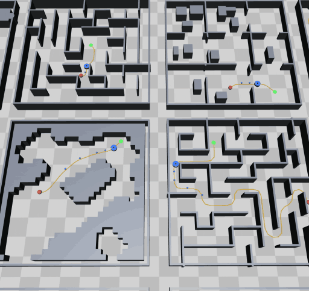

# DWARL

DWARL is a learned local controller for differential-drive robots using ROS 2
Nav2. Train a policy in MuJoCo, test it in MuJoCo or Gazebo, and deploy it as an
ONNX bundle. DWARL is experimental and does not include a pretrained navigation policy.



[**Open the documentation →**](https://nobleo.github.io/dwarl/) · [Try the example robot](https://nobleo.github.io/dwarl/quickstart/) · [Explore the interactive theory diagram](https://nobleo.github.io/dwarl/architecture/)

## Where to start

| I want to… | Start here |
| --- | --- |
| Understand one steering decision | [System architecture](https://nobleo.github.io/dwarl/architecture/) — click **DWARL** inside Nav2 to explore the actor, dynamic window and training loop |
| Watch a robot learn | [Quickstart](https://nobleo.github.io/dwarl/quickstart/) — install Pixi and run the MuJoCo demo |
| Use my robot | [Integrate a robot](https://nobleo.github.io/dwarl/integrate-robot/) → [Generate maps](https://nobleo.github.io/dwarl/datagen/) → [Train](https://nobleo.github.io/dwarl/train/) |
| Run workflows from a browser | [Local dashboard](https://nobleo.github.io/dwarl/monitor/#watch-in-the-dashboard) — after setup, use `pixi run web` to train, test and deploy |
| Decide which checkpoint to deploy | [Test a checkpoint](https://nobleo.github.io/dwarl/test/) → [Read the results](https://nobleo.github.io/dwarl/results/) → [Deploy to Nav2](https://nobleo.github.io/dwarl/deploy/) |

For simulator setup, controller comparisons, configuration and troubleshooting, see the [full documentation](https://nobleo.github.io/dwarl/).

## Workspace layout

Run `pixi` commands from the repository root. [`pixi.toml`](pixi.toml) defines
the shared environments and tasks for three components:

| Component | What lives here | How Pixi uses it |
| --- | --- | --- |
| [`dwarl/`](dwarl/) | Python CLI, simulator, training and evaluation | Installs the local package in editable mode |
| [`ros/`](ros/) | ROS 2 packages for Nav2 and Gazebo | `pixi run build` builds the packages with colcon |
| [`web/`](web/) | Dashboard frontend and documentation | `pixi run web-build` builds the frontend and docs into the Python package |

Component tests live alongside their code. Cross-component checks live in
[`tests/integration/`](tests/integration/). Run `pixi run pytest` for the Python
package and workspace integration suites, `pixi run web-test` for browser tests,
and `pixi run ros-test` for native ROS tests.

## Get started

[Try the example robot](https://nobleo.github.io/dwarl/quickstart/) to watch a TurtleBot3 train and navigate in MuJoCo.
The quickstart covers installing Pixi and reclaiming disk space afterward.
A [Docker demo](docker/README.md) is also available on a best-effort basis.

## Train, test and deploy

For your own robot or a standard training run, use the workflow below instead.
To adjust map counts or training settings, see [configuration](https://nobleo.github.io/dwarl/configuration/).

```bash
pixi run setup
pixi run train --preset navigation
pixi run test --suite validation
pixi run dwarl report --open
```

Use validation results to select a checkpoint and held-out tests for final
evaluation. When ready, run `pixi run deploy` to install the policy bundle.

[Integrate your robot](https://nobleo.github.io/dwarl/integrate-robot/) ·
[Full documentation](https://nobleo.github.io/dwarl/)

## License

[Apache License 2.0](LICENSE) — Copyright 2026 Nobleo Technology.
