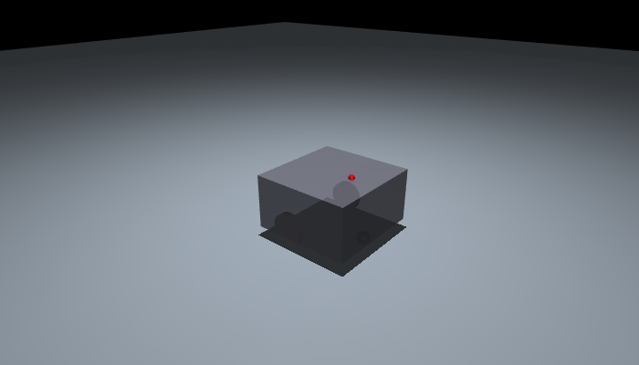

# Integrate your robot

**Goal:** turn your robot description into a checked DWARL integration and a first
pipeline run. DWARL supports differential drive with a 2D lidar.

Bring a URDF/xacro, the physical footprint, command limits and filtered lidar
settings. Keep the integration in your robot repository.

## 1. Start setup

From the DWARL checkout:

```bash
pixi run setup
```

Choose **Integrate my robot** and select its workspace. If there is no integration,
setup opens the robot wizard. A typical destination is
`../my_robot/src/my_robot_dwarl`.

You can open the same wizard directly:

```bash
pixi run dwarl robot init ../my_robot/src/my_robot_dwarl
```

## 2. Describe the robot

The wizard walks through description, drive, footprint, sensing and ROS interfaces.
It suggests joints and links from the expanded URDF. Enter your robot's actual
velocity/acceleration limits and the lidar's **post-filter** field of view and range.

- Press **Tab** for choices; use `:back` to revisit a field within a section.
- Enter a rectangle with an offset, a radius about the base origin, or an ordered convex polygon.
- Review actuator and contact assumptions, especially support/caster geometry.
- Ctrl+C preserves a draft. Rerun the same command to continue.

The wizard validates the model and creates the profile, ROS package and selected-policy
navigation wrapper. Existing user-edited launch files are preserved. Updates show a diff.

??? info "Scripted creation and existing profiles"

    Supply a complete profile and package metadata:

    ```bash
    pixi run dwarl robot init ../my_robot/src/my_robot_dwarl \
      --answers robot.yaml --maintainer 'Robot team' --email team@example.org --yes
    ```

    Use `--profile-only` for an integration without ROS scaffolding, `--set path=value`
    for an override, and `--update` to apply displayed changes. Relative asset paths
    in the input profile resolve beside that input file. A missing required value
    is reported rather than guessed. See the [profile reference](reference/robot-profile.md).

<a id="6-add-gazebo-testing"></a>
## 3. Add Gazebo if you need it

If you plan to evaluate this run in Gazebo, configure the adapter **before training**.
The wizard can wrap an existing robot-only simulation launch and map its world/spawn
arguments. It then offers a live interface check.

Already have an integration? Use
`pixi run dwarl robot init ../my_robot/src/my_robot_dwarl --gazebo`.
The [Gazebo how-to](gazebo.md) explains the adapter contract and live checks.

<a id="2-add-a-robot-integration"></a>
## 4. Inspect the training model

```bash
pixi run dwarl robot check
pixi run dwarl robot view
```

Expect a report with mass, wheel geometry, lidar transform and possible mismatches.
The viewer shows the simplified training geometry on a floor. Check that the body
rests correctly and that wheel and sensor positions match the real robot. Close the
viewer to continue. See [manual model details](manual-integration.md#model-conventions)
and [troubleshooting](troubleshooting.md) when a model needs adjustments.



*Example: the public testbot fixture. Inspect your own robot's geometry and support points.*

<a id="3-smoke-test-the-training-pipeline"></a>
## 5. Exercise the pipeline

```bash
pixi run train --preset smoke
```

This creates a tiny dataset and runs two training iterations. Follow its printed,
run-specific test command to exercise export and inference. A smoke policy is only
a pipeline check; failed navigation is expected.

Setup remembers the selected robot, so subsequent commands do not need its path.
At any point, ask:

```bash
pixi run dwarl status
pixi run dwarl next
```

<a id="4-train-and-monitor"></a>
**Next:** [Train a navigation policy](train.md).

<a id="5-evaluate-a-trained-checkpoint"></a>
Then [evaluate it](test.md) and [deploy it to Nav2](deploy.md).
<a id="7-export-and-install-the-network"></a>
<a id="8-run-with-nav2"></a>
