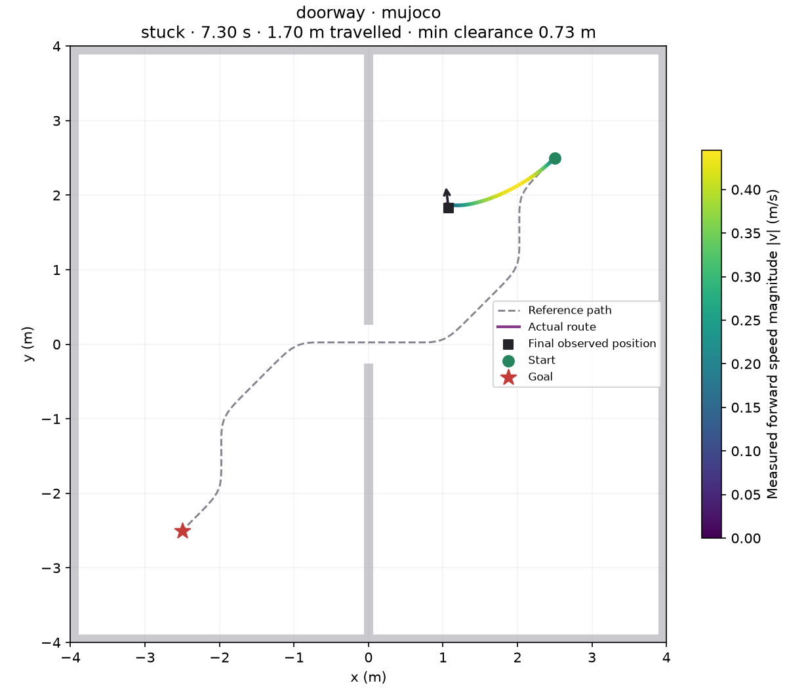

# Test and understand results

**Goal:** evaluate a completed checkpoint and inspect how it navigates.

## Run a validation workload

```bash
pixi run test --suite validation
```

The selected robot's navigation run is preferred over its smoke run. DWARL prints
the resolved run, iteration and hash before executing. For explicit selection:

```bash
pixi run test --run runs/<run> --checkpoint best --suite validation
```

`best` requires completed periodic validation during training. An iteration number
pins a checkpoint; `latest` selects the latest completed checkpoint in the selected run.

## Read the result

**Open the report after testing.** The terminal table is only a summary; the browser
report contains controller comparisons, individual outcomes and linked plots.

```bash
pixi run dwarl report --open
```

This opens the latest recorded result for the selected run. To avoid opening an
older or interrupted result, use the exact directory printed by the test command:

```bash
pixi run dwarl report runs/<run>/tests/<test-id> --open
```

The page lives at `runs/<run>/tests/<test-id>/report/index.html`.
Check its **Status**, checkpoint and **Completed** counts before interpreting it.
`episodes.json` updates during testing; the summary and plotted report are generated
at completion or interruption. An interrupted report can contain all cases for the
first controller, some for the next, and none for controllers that never started.
Missing sections do not mean those controllers passed or failed.

Start with completed cases, success and collision rates. Inspect failed episodes,
their trajectory and command/measured-motion plots. Missing measurements are
shown as unavailable. A finished workload is not automatically a passed workload.

See [the report reading guide and remote-copy instructions](results.md#open-and-read-the-report).

??? example "What an episode plot looks like"

    

    This is an illustrative smoke run of the public testbot fixture, not a navigation-quality result.

| Exit code | Meaning |
| --- | --- |
| `0` | Workload passed |
| `1` | Completed workload failed navigation criteria |
| `2` | Input or infrastructure failure |
| `130` | Interrupted; available partial results retained |

## Expand evaluation

```bash
pixi run test --case doorway --show
pixi run test --sim both --suite validation
```

Gazebo requires a [checked adapter](gazebo.md). Default tests run at most 32 cases
per simulator; `--set test.max_cases=3` gives a shorter check.

Choose candidates on **validation**. Once the candidate is frozen, run the held-out
test suite with an explicit run/checkpoint:

```bash
pixi run test --run runs/<run> --checkpoint <iteration> --suite test
```

[Detailed metrics](results.md) · [Compare controllers](compare.md)

**Next:** [deploy the selected checkpoint](deploy.md).
