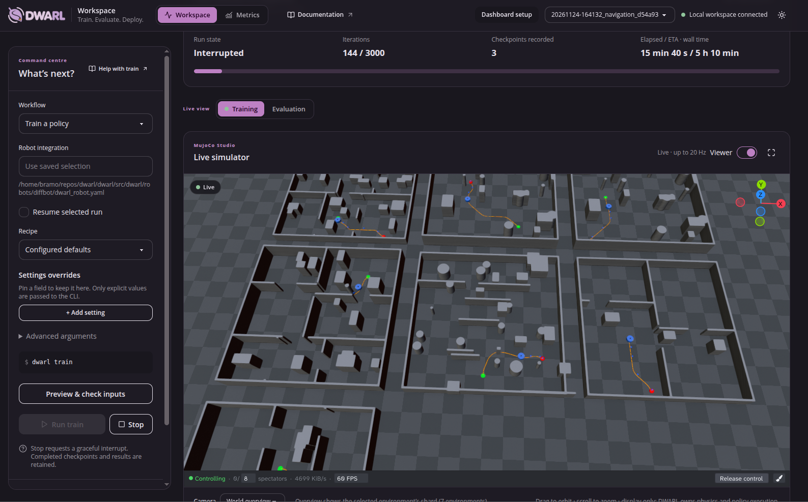
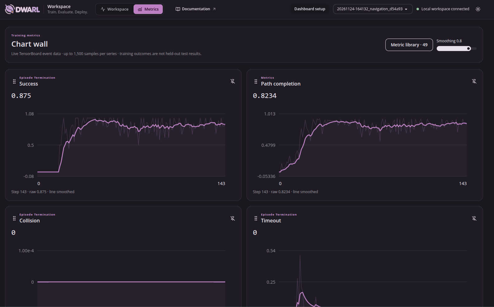

# Get started

[Explore the interactive system architecture](architecture.md) — follow one steering decision from a training rollout to a Nav2 command. Select any component to see how it works.

- [Try the example robot](quickstart.md) — `pixi run demo` handles setup and opens MuJoCo so you can watch training.
- [Integrate your robot](integrate-robot.md) — `pixi run setup` guides you through your robot’s model and sensors.

Prefer a browser? After setup, run `pixi run web` to open the [local dashboard](monitor.md#watch-in-the-dashboard). Its **Workflow** menu lets you train, test and deploy using the same commands as the CLI, then inspect metrics and reports.

!!! tip "Using a coding agent?"
    Open it in the DWARL checkout and ask: “Follow `AGENTS.md` to set up `/path/to/my_robot` for MuJoCo.” If you also need Gazebo, ask for a live Gazebo interface check.

## Train, test and deploy

- **01 · Train**

    Build robot-sized datasets and train a policy. Start with a tiny pipeline check.

    [Train a policy →](train.md)

- **02 · Test**

    Evaluate exact checkpoints and inspect success, collision and per-case behavior.

    [Understand results →](test.md)

- **03 · Deploy**

    Install a complete ONNX bundle and connect the controller to Nav2.

    [Deploy to Nav2 →](deploy.md)

## How-to guides and reference

- [Monitor or resume training](monitor.md)
- [Set up Gazebo](gazebo.md) · [Compare controllers](compare.md)
- [Configuration](configuration.md) · [CLI reference](reference.md) · [Troubleshooting](troubleshooting.md)

[{ width="144" }](https://nobleo-technology.nl/)
